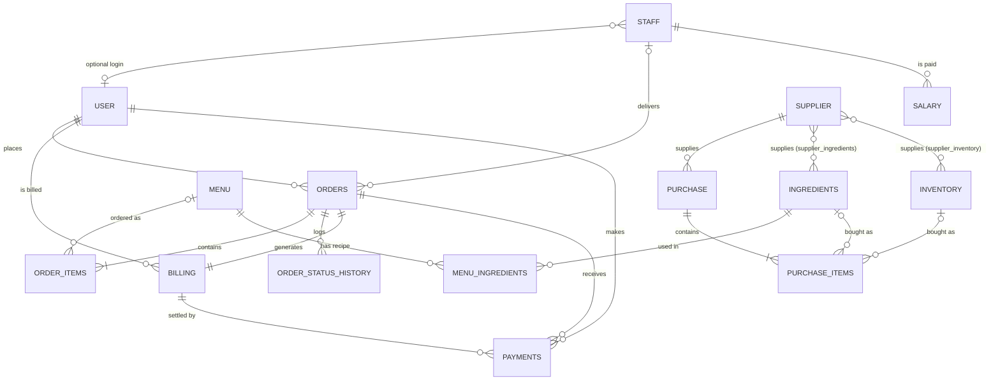

# Database schema

SQL database (MySQL by default) managed through Sequelize. Every table is defined in one place:
[`backend/models.js`](../backend/models.js) (columns + foreign keys). Tables are created automatically
the first time the backend starts (`npm run seed` or `npm run dev`). Table names are generated by Sequelize
(normally the plural of the model name) — run `SHOW TABLES;` in MySQL to see them.

## Relationship diagram

## ER entity → backend model

| ER entity (diagram) | Model in `models.js` | Notes |
|---|---|---|
| USER | `User` | Customers **and** logins for staff/admin; `role` column; password stored as bcrypt hash |
| STAFF | `Staff` | chef / delivery / manager / helper / cashier; optional link to a `User` login |
| SALARY | `Salary` | One row per staff member per month (`YYYY-MM`, unique together) |
| MENU | `MenuItems` | name, category, `foodType` (Veg / Non-Veg), price, availability |
| MENU_INGREDIENTS | `MenuIngredient` | Recipe: quantity of an ingredient for **one** serving |
| ORDERS | `Order` | Status workflow, delivery address copied at order time |
| ORDER_ITEMS | `OrderItem` | Name/price snapshot so later menu changes don't alter old orders |
| *(added)* | `OrderStatusHistory` | Audit log of status changes |
| BILLING | `Billing` | Exactly one bill per order, created automatically |
| PAYMENTS | `Payment` | Payment attempts against a bill |
| INGREDIENTS | `Ingredient` | Raw-material stock, with reorder level |
| INVENTORY | `InventoryItem` | Non-food stock (packaging, utensils…) |
| SUPPLIER | `Supplier` | + join tables `supplier_ingredients`, `supplier_inventory` |
| PURCHASE | `Purchase` | Stock is added only when a purchase is marked *received* |
| *(added)* | `PurchaseItem` | Each line is an ingredient **or** an inventory item |

## Delete rules (foreign keys)
- Deleting an order also deletes its items, status history and bill; it is **blocked** if payments exist (cancel it instead).
- A user with orders, a supplier with purchases, a staff member with salary records, or an ingredient used in a recipe cannot be deleted — the API returns `409`.
- Deleting a dish keeps old orders intact (their name/price snapshot stays).
